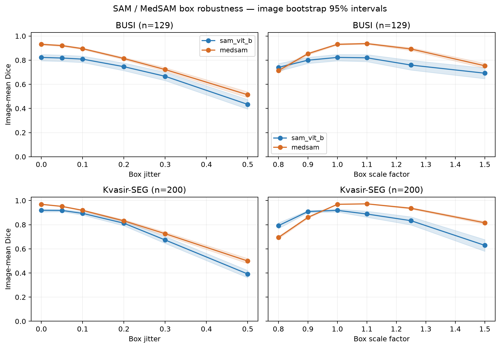

# Phase 2: Role C analysis and remaining work

## Teammate experiment integration

The teammate supplied `P100 Result/p1_03_p1_kvasir_pilot_b670576.zip`, an aggregate
CSV and two comparison images. The raw archive, not screenshot values, is used for
analysis. It contains SAM ViT-B and MedSAM on all 200 committed Kvasir test images:
4800 rows each, 9600 total, with 24 box configurations/image. No ViT-H result is
included. No processing errors or invalid rows; four SAM empty predictions are
retained. Aggregate values were checked against raw means and counts. The
`environment_colab.json` says **Tesla T4**, despite the folder's P100 name; the
hardware is reported from the log. Source code commit: `b670576`.

The teammate ran pretrained inference using the existing P1_03 notebook. Role C's
new contribution here is validation, integration, statistics and interpretation,
not authorship of the teammate's experiment or the existing model wrappers.
Raw files remain in `results/raw/p1_kvasir_pilot/`; the original classical baseline
is preserved. Reproduce using `configs/p2_kvasir_box_completed.yaml`.

## Shared-model comparison

| Test dataset | Model | Exact-box Dice | Jitter 20% Dice | Paired Dice decline [95% CI] |
|---|---|---:|---:|---:|
| BUSI (129 images) | SAM ViT-B | .8229 | .7461 | .0768 [.0586, .0973] |
| BUSI (129 images) | MedSAM | .9315 | .8138 | .1177 [.1065, .1287] |
| Kvasir (200 images) | SAM ViT-B | .9190 | .8125 | .1065 [.0888, .1251] |
| Kvasir (200 images) | MedSAM | .9692 | .8322 | .1370 [.1269, .1476] |

MedSAM's higher starting Dice does not imply the smallest absolute drop. On
Kvasir, a box scaled to .8 gives SAM .7921 versus MedSAM .6938; at .9, .9090 versus
.8608. Box shrinkage is therefore a useful failure condition to discuss, rather
than claiming MedSAM is uniformly more robust.



Seeds are averaged within each image; intervals resample images. These are two
different medical cohorts, not paired observations and not a natural-versus-medical
comparison. No between-dataset paired significance test is performed. BUSI is
listed as seen by MedSAM; Kvasir is listed as unseen in `docs/leakage.md`. Different
image characteristics and pretraining overlap prevent a causal domain conclusion.
The underlying raw-source hashes are in `results/summary/busi_kvasir/sources.json`.

## Preliminary BUSI failure review

Six existing ranked panels were visually inspected; observations are recorded in
`results/summary/c_busi_box/failure_cases/review_ai.csv`. The original blank human
review CSV is preserved. This is AI-assisted preliminary review; explanations
require team confirmation and are not clinical diagnoses or proven causes.

Four cases show wrong-region/background selection after a shifted or truncated
box. One narrow-box case retains only 1.57% of target pixels while 93.58% of its
small predicted region overlaps the target: a severe undersegmentation example.
The expanded-box ViT-H case retains only 6.53% of target pixels although the
prompt surrounds the target, showing that errors need not be simple prompt
clipping. Image overlays, rulers and appearance are potential confounders.

Panels render seed 0; rankings use seed-averaged drops. These are selected extreme
examples (five SAM ViT-B, one ViT-H), not a random failure sample. Their model
counts do not estimate comparative failure frequency. Precision/recall were
recovered from Dice and recorded prediction/target areas, without discarding low
scores. Team review should confirm categories before report submission.

## Remaining dependencies

- BUSI clicks: implementation, oracle protocol, resume tests and Colab notebook
  are added; actual full-run status is documented separately after execution.
- U-Net results/checkpoints are still needed for prompt-free baseline and crossover
  claims. Coordinate with Role B; do not report a missing baseline as complete.
- COCO/natural-image and ISIC experiments are not supplied by this Kvasir archive.
  Full project coverage requires the corresponding owners' outputs.
- Final human failure review and final presentation/report integration remain.

```bash
python scripts/analyze_results.py --config configs/p2_kvasir_box_completed.yaml
python scripts/compare_busi_kvasir.py
```
