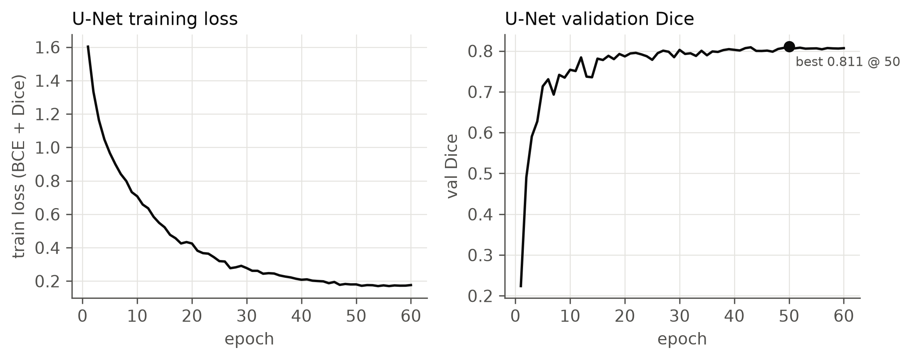
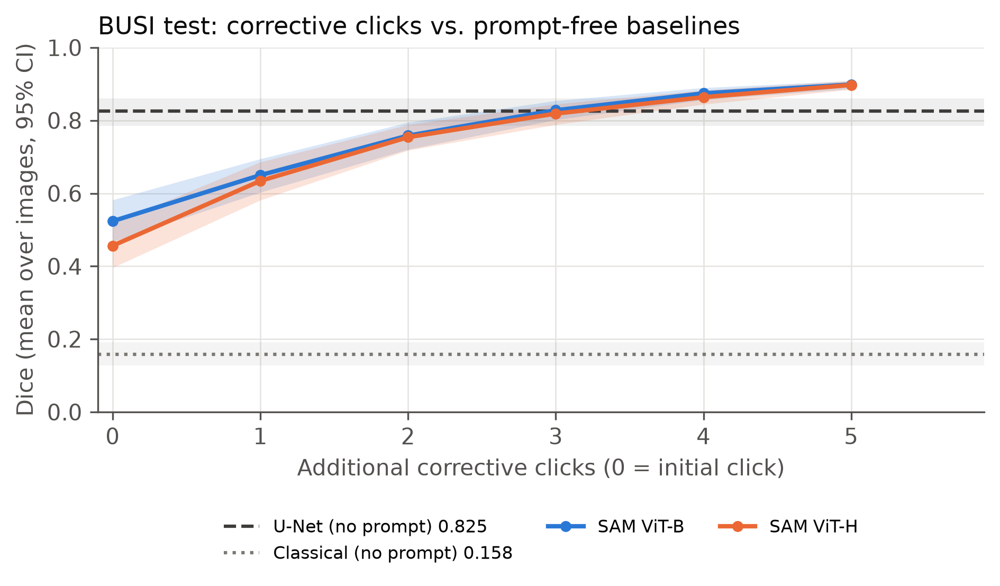
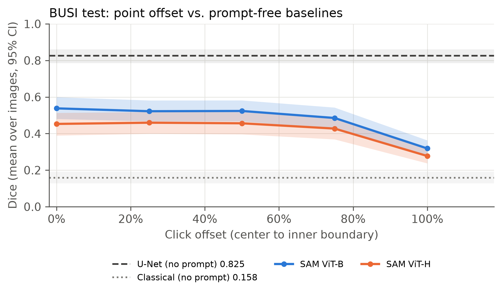
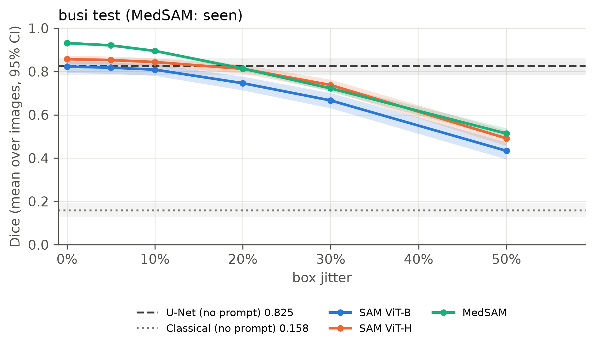

# Role C: completed Phase 2 BUSI experiments

Completed on Google Colab Tesla T4 on November 20, 2026. This work reuses the
team's data loaders, fixed splits, SAM wrappers, point-offset simulator, metrics
and baseline implementations. Role C adds the click/correction runner, trace and
integrity validation, statistical comparisons, figures and failure observations;
it also runs the existing supervised and classical baselines on BUSI.
The teammate's Kvasir inference is credited separately in
[the cross-dataset report](phase2_role_c_progress.md).

## Coverage and provenance

- BUSI: 452 training / 65 validation / **129 test images**, containing 130 test objects.
- Clicks: SAM ViT-B and ViT-H, 33 configurations per image (15 offsets plus
  18 correction-round/seed combinations): **4257 rows/model, 8514 total**.
- Each model also has 4290 point-trace rows. Initial points match between models;
  adaptive corrections can differ. No repeated correction position or empty
  prediction was found; all image/configuration blocks are present, with no errors.
- Click source: `4ce3de086842b4edf094d04dad88d9828ee8a4e0`.
  Smoke, full inference and initial analysis together took 1382.79 s (23 min 3 s).
- Baseline/demo source: `74ac661`. Environment versions are preserved in
  `results/raw/c_busi_box/unet_environment.json`; original box-run metadata is
  separate because those predictions were produced on November 9.
- `results/phase2_export_manifest.json` records the original GPU export hashes and
  best-checkpoint hash. The checkpoint stays on Drive under
  `checkpoints/c_busi_box/unet_best.pt`; model weights and datasets are not in Git.
- All 39 exported files were verified before import. Local recomputation matched
  every exported statistical table to numerical tolerance 1e-12. Figures were
  subsequently regenerated locally to prevent legend/reference-line overlap.
  See `results/phase2_validation.json` for the validation record.

## Prompt-free baselines

| Method | Test mean Dice | Image-bootstrap 95% CI |
|---|---:|---:|
| U-Net | 0.8251 | [0.7851, 0.8605] |
| Classical | 0.1582 | [0.1277, 0.1910] |

U-Net uses the existing ResNet34/ImageNet encoder, 352-pixel input, BCE + Dice loss,
AdamW, batch size 8 and seed 0. All 60 epochs completed. **Epoch 50** had the best
validation Dice (**0.8106**) and was selected before testing. The sum of recorded
training/validation epoch times is 1468.11 s; this excludes some checkpoint-write
and setup time. Only one training seed was run.

The classical baseline searches the existing 90 configurations on **training
images only**. It selected HSV value / low polarity / sigma 4 / radius 10. Its
training/validation Dice were 0.1688/0.1478. Its weak test score is retained;
parameters were not retuned after seeing the test result.



## Point offset and corrective clicks

Single-click means fall as prompts move toward the inner object boundary:

| SAM variant | Center offset 0 | Offset 0.5 | Boundary offset 1 |
|---|---:|---:|---:|
| ViT-B | 0.5378 | 0.5236 | 0.3186 |
| ViT-H | 0.4527 | 0.4562 | 0.2774 |

Offsets remain inside the target and retain positive labels. This experiment
measures location sensitivity, not the effect of falsely labeling background.

Correction round 0 starts at offset 0.5 with **one initial click per object**.
Each later round adds one click per object, using the deepest unused pixel of the
largest false-negative/false-positive error component. Previous clicks and logits
are retained. Thus five corrections mean up to **six total clicks per object**.
Ground-truth masks simulate an oracle user; later prompts are model-dependent.

| Additional corrections | SAM ViT-B Dice | SAM ViT-H Dice |
|---:|---:|---:|
| 0 | 0.5236 | 0.4562 |
| 1 | 0.6499 | 0.6341 |
| 2 | 0.7583 | 0.7540 |
| 3 | 0.8280 | 0.8188 |
| 4 | 0.8743 | 0.8639 |
| 5 | **0.8984** | **0.8974** |

Paired mean gains from round 0 to round 5 are **0.3749 [0.3218, 0.4280]** for
ViT-B and **0.4412 [0.3838, 0.4985]** for ViT-H. After five corrections, paired
mean differences versus U-Net are 0.0734 [0.0404, 0.1107] and
0.0723 [0.0382, 0.1094], respectively. Corresponding Wilcoxon/Holm p-values are
0.000571 and 0.001122. These conditional oracle results do not measure human
annotation time or establish clinical performance.

Although ViT-B has higher descriptive single-click means, no B-versus-H
comparison survives the specified within-family Holm correction. The nearly equal
final means do not prove equivalence. Three corrections bring the means close to
U-Net, but do not demonstrate a significant advantage over it.




## Box crossover with U-Net

The original three-model box predictions are unchanged; new baseline results
complete their comparison on the same 129 images.

| Model | Exact-box Dice | First sampled jitter with mean below U-Net | Descriptive interpolation |
|---|---:|---|---|
| SAM ViT-B | 0.8229 | Already below at 0% | 0% |
| SAM ViT-H | 0.8573 | 20% | 15.96% |
| MedSAM | 0.9315 | 20% | 18.62% |

ViT-B's exact-box mean is only 0.0022 below U-Net's; “below at 0%” should not be
read as a large practical gap. Interpolated crossings are descriptions of the
mean curves, not significance or clinical thresholds. The supplied paired tests
assess signed-rank distributions; they are not tests of equality of means.



## Interpretation, limitations and remaining team work

The results support prompt sensitivity and recovery through corrective feedback
on this BUSI cohort. They do not show that larger SAM models are uniformly better,
or that MedSAM is uniformly more robust. BUSI is listed as seen by MedSAM in
`docs/leakage.md`. Splits and bootstrap units are images, not patients, because
patient IDs are unavailable. Intervals condition on the single trained checkpoint.
Seeds are averaged within images before bootstrap or paired tests; Holm correction
is across levels within each model-pair/perturbation family.

The real Gradio HTTP demo passed two box settings on a BUSI test image using
actual SAM ViT-B/MedSAM weights. Both models received the same box. It displayed
predictions without claiming Dice scores, since no ground truth was supplied to
the demo. Outputs and timings are in `results/validation/real_demo/`.

Six selected box-failure panels have preliminary AI-assisted observations in
`results/summary/c_busi_box/failure_cases/review_ai.csv`; human confirmation is
still pending. They are extreme examples, not failure-rate estimates. Other
owners' COCO/ISIC experiments, Kvasir ViT-H and missing non-BUSI U-Net outputs are
not supplied by the imported Kvasir archive. Two medical datasets alone cannot
establish a natural-versus-medical domain conclusion.

## Reproduction

Run `C_02_busi_clicks.ipynb` and `C_03_busi_baselines_demo.ipynb` on Colab. For
analysis of the committed outputs:

```bash
python scripts/analyze_results.py --config configs/c_busi_box.yaml
python scripts/analyze_click_results.py --config configs/c_busi_clicks.yaml
python scripts/summarize_busi_phase2.py
python scripts/compare_busi_kvasir.py
```

Validation: 195 tests passed, 5 optional dependency checks skipped, 3 slow tests
not selected; the four U-Net tests passed after the CUDA-resume fix. Changed Python
modules pass Ruff. Synthetic unit-test scores are excluded from experiment results.
