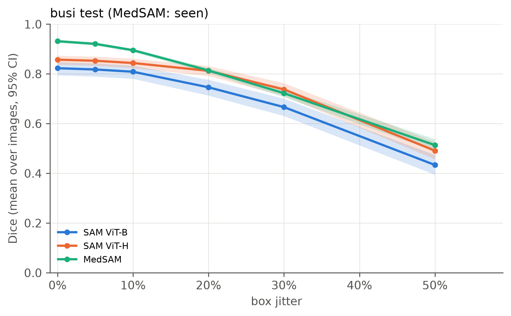

# Role C: completed BUSI box experiment

Run on Google Colab Tesla T4 on November 9, 2026 (Los Angeles).
The three-model full run took **1044.04 seconds (17 min 24 sec)**, excluding setup,
the three-image smoke test and case rendering. Source commit:
`d9ce3d2962f9d1c7de3a3de9f1d78280232830f1`.
Environment and counts: `results/raw/c_busi_box/run_metadata.json`.

## Coverage

- Fixed BUSI split: 452 train / 65 validation / **129 test images** (130 test objects).
- Three pretrained models: SAM ViT-B, SAM ViT-H and MedSAM; no fine-tuning.
- Per image: box jitter 6 levels x 3 seeds plus box scale 6 levels = 24 configurations.
- **3096 image-level rows per model; 9288 total.** No missing/duplicate configurations,
  invalid rows or processing errors. SAM ViT-B produced one empty prediction,
  retained in the metrics rather than discarded.
- Seeds are averaged within images before statistical analysis.
- Six ranked failure-case figures and a review CSV are included; causal review fields remain blank.

## Mean Dice versus box jitter

| Model | 0% | 10% | 20% | 30% | 50% |
|---|---:|---:|---:|---:|---:|
| SAM ViT-B | 0.8229 | 0.8087 | 0.7461 | 0.6664 | 0.4336 |
| SAM ViT-H | 0.8573 | 0.8438 | 0.8124 | 0.7377 | 0.4911 |
| MedSAM | 0.9315 | 0.8953 | 0.8138 | 0.7222 | 0.5135 |



MedSAM has the highest mean Dice with exact boxes. Its paired decline from 0% to
20% jitter is **0.1177** (95% bootstrap CI **[0.1065, 0.1287]**), compared with
**0.0768 [0.0586, 0.0973]** for SAM ViT-B and **0.0450 [0.0339, 0.0574]** for SAM ViT-H.
Higher exact-box performance therefore does not imply the smallest decline. At
20% jitter, MedSAM and SAM ViT-H have similar means; descriptive means alone do not
establish equivalence. `paired_tests.csv` contains image-paired Wilcoxon tests,
with Holm correction across levels within each model pair/perturbation family.

## Files and reproduction

- Raw per-image/per-object CSVs and metadata: `results/raw/c_busi_box/`.
- Metric means/intervals, paired tests, rankings, PNG/PDF curves:
  `results/summary/c_busi_box/`.
- Case panels and blank review fields: `results/summary/c_busi_box/failure_cases/`.
- Protocol: `configs/c_busi_box.yaml`, `configs/default.yaml`, `splits/busi.json`.

```bash
python scripts/analyze_results.py --config configs/c_busi_box.yaml
python scripts/make_failure_cases.py --config configs/c_busi_box.yaml --top 6
```

Figures were regenerated locally with the same raw CSVs/configuration. Redundant
endpoint labels were removed to avoid overlapping text. Means and confidence
intervals were checked against the Colab export.

## Scope and limitations

BUSI is marked **seen by MedSAM** in `docs/leakage.md`; this is not an unseen-domain
result. The split is image-level, not patient-level. Ground-truth masks construct
the reference prompts. **U-Net and classical baselines were not run**, so crossover
conclusions cannot yet be made. Click experiments and manual failure-cause review
are also not completed by this run.
