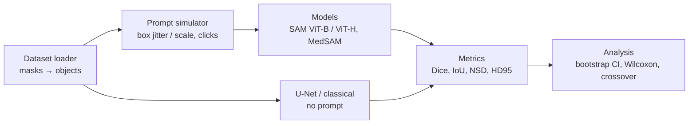

<!-- Generated by scripts/make_report_tables.py from phase1_report.template.md; edit the template, not this file. -->

# Phase 1 Report — Prompt Robustness of SAM / MedSAM

CS 5330 · Team 04 · Ruoyu Wang (A), Hao Wang (B), Jiani He (C)

> Status: draft. Every number below comes from a table generated by `scripts/make_report_tables.py` from CSVs in this repo. `TBD` = not run yet.

## 1. Goal and research questions

Promptable segmentation models are usually evaluated with near-perfect box prompts derived from the ground truth. We perturb the prompts on purpose and measure how much Dice drops, and compare against a supervised U-Net that needs no prompt.

- **RQ1** How fast does Dice drop for SAM ViT-B, SAM ViT-H and MedSAM as box error (shift / scale) grows? (P1 pilot on Kvasir-SEG)
- **RQ2** Is the drop different on natural images (COCO) vs. medical images? (P2)
- **RQ3** At what prompt-error level does the U-Net overtake the foundation models? (P1 preliminary, P2 final)
- **RQ4** Effect of click offset and of corrective clicks? (P2)
- **RQ5** (stretch) Does fine-tuning MedSAM's mask decoder with wider box noise improve robustness? (P3)

Phase 1 builds the full framework and runs an end-to-end pilot on Kvasir-SEG.

## 2. Pipeline

- **Data**: masks are binarized, split into connected components (specks removed); one box per component, computed from the mask. Fixed seed-42 split, shared by every method.
- **Prompts**: a perturbed prompt depends only on (image, object, perturbation, level, seed) through a SHA-256 key, never on the model, so model comparisons are paired.
- **Models**: SAM through the official `SamPredictor`; MedSAM following the official `MedSAM_Inference.py` step by step.
- **Runner**: each image is encoded once and decoded for every configuration; results are long-format CSVs; runs resume after a disconnect.

## 3. Sanity checks

### 3.1 Data

| dataset | train | val | test | objects (test) |
|---|---|---|---|---|
| Kvasir-SEG | 700 | 100 | 200 | 220 |
| COCO val2017 | 0 | 0 | 1000 | 1000 |

Full statistics (image sizes, objects per image, object area fractions, specks removed): `docs/data_stats.md`.

Kvasir-SEG in MedSAM training data (from `docs/leakage.md`): **unknown**

### 3.2 Model parity

**MedSAM wrapper vs. official `MedSAM_Inference.py`** (GT boxes)

| image_id | dice_ours_vs_official | pixels_differ | pass |
|---|---|---|---|
| cju0qoxqj9q6s0835b43399p4 | 1.000000 | 0 | True |
| cju0s2a9ekvms080138tjjpxr | 1.000000 | 0 | True |
| cju0tl3uz8blh0993wxvn7ly3 | 1.000000 | 0 | True |

**SAM wrapper vs. direct `SamPredictor`**

| model | images | identical | pixels_differ |
|---|---|---|---|
| sam_vit_b | 3 | True | 0 |

Run on: device = cpu, gpu = none, torch = 2.15.0+cpu, python = 3.11.18, platform = Windows

## 4. Pilot results on Kvasir-SEG (preliminary)

Test split × 3 models × box jitter (6 levels × 3 seeds) + box scale (6 levels).

### 4.1 Run integrity

TBD — pilot not run yet (notebook P1_03)

### 4.2 Box jitter

TBD — pilot not run yet

TBD — pilot not run yet

Figure: `figures/p1_kvasir_box_jitter.png` (P1-12, owner C; U-Net reference line from P1-10, owner B) — TBD.

### 4.3 Box scale

TBD — pilot not run yet

Figure: `figures/p1_kvasir_box_scale.png` — TBD. Dice vs. box IoU: `figures/p1_kvasir_dice_vs_boxiou.png` — TBD.

### 4.4 U-Net and classical baselines, preliminary crossover

TBD — U-Net (P1-10, owner B), classical baseline (P1-11, owner C), crossover and statistics (P1-12, owner C).

## 5. Issues and design decisions

Full log with dates and reasons: `docs/decisions.md`. Main points:

- **Invalid prompts are never dropped.** A row is always written; if any object's prompt in an image is invalid the whole row is flagged `invalid` with NaN metrics, so row counts stay checkable.
- **MedSAM follows the official source**, not our earlier description: bicubic resize with anti-aliasing then truncation to uint8, global min-max normalization, no SAM pixel normalization. Loading MedSAM weights with the facebookresearch registry gives the same embeddings as MedSAM's bundled code, so no vendored copy is needed.
- **Parity-test trap**: the official script names its output after the input file, so a JPEG input produces a lossy JPEG mask. The parity harness feeds a lossless PNG copy.
- **Image border**: pixels on the image border count as object boundary, both for NSD/HD95 surfaces and for click depth, so objects cut by the border are handled consistently.
- **COCO**: one instance is one object, even when occlusion splits it into fragments (to be confirmed for P2).

## 6. Plan for Phase 2

- Run the same pipeline on ISIC 2018, BUSI and COCO (configs only; loaders in place or in progress).
- Click-offset experiments and corrective multi-click (largest error region, distance-transform maximum).
- U-Nets for ISIC and BUSI (3 seeds); Wilcoxon + Holm across levels; final crossover table; seen vs. unseen datasets reported separately.

## 7. Contributions

See `CONTRIBUTIONS.md` (per task owner and status).

## 8. AI usage statement

AI assistance (Claude Code) was used and is disclosed task by task in `AI_USAGE_LOG.md`, including which files were generated or modified and who reviewed them. The allowed level of AI use is being confirmed with the TA.
