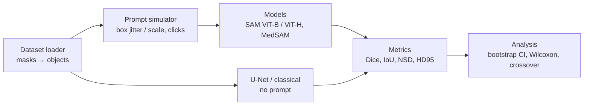

# Phase 1 Report — Prompt Robustness of SAM / MedSAM

CS 5330 · Team 04 · Ruoyu Wang (A), Hao Wang (B), Jiani He (C)

> Status: draft. Every number below comes from a table generated by `scripts/make_report_tables.py` from CSVs in this repo. `TBD` = not run yet.

## 1. Goal and research questions

Promptable segmentation models are usually evaluated with near-perfect box prompts derived from the ground truth. We perturb the prompts on purpose and measure how much Dice drops, and compare against a supervised U-Net that needs no prompt.

- **RQ1** How fast does Dice drop for SAM ViT-B, SAM ViT-H and MedSAM as box error (shift / scale) grows? (P1 pilot on Kvasir-SEG)
- **RQ2** Is the drop different on natural images (COCO) vs. medical images? (P2)
- **RQ3** At what prompt-error level does the U-Net overtake the foundation models? (P1 preliminary, P2 final)
- **RQ4** Effect of click offset and of corrective clicks? (P2)
- **RQ5** (stretch) Does fine-tuning MedSAM's mask decoder with wider box noise improve robustness? (P3)

Phase 1 builds the full framework and runs an end-to-end pilot on Kvasir-SEG.

## 2. Pipeline

- **Data**: masks are binarized, split into connected components (specks removed); one box per component, computed from the mask. Fixed seed-42 split, shared by every method.
- **Prompts**: a perturbed prompt depends only on (image, object, perturbation, level, seed) through a SHA-256 key, never on the model, so model comparisons are paired.
- **Models**: SAM through the official `SamPredictor`; MedSAM following the official `MedSAM_Inference.py` step by step.
- **Runner**: each image is encoded once and decoded for every configuration; results are long-format CSVs; runs resume after a disconnect.

## 3. Sanity checks

### 3.1 Data

<!-- include: tables/data.md -->

Full statistics (image sizes, objects per image, object area fractions, specks removed): `docs/data_stats.md`.

<!-- include: tables/leakage_label.md -->

### 3.2 Model parity

<!-- include: tables/parity.md -->

## 4. Pilot results on Kvasir-SEG (preliminary)

Test split × 3 models × box jitter (6 levels × 3 seeds) + box scale (6 levels).

### 4.1 Run integrity

<!-- include: tables/p1_pilot_integrity.md -->

### 4.2 Box jitter

<!-- include: tables/p1_pilot_box_jitter.md -->

<!-- include: tables/p1_pilot_delta.md -->

Figure: `figures/p1_kvasir_box_jitter.png` (lines = foundation models with 95% CI bands; dashed = U-Net, dotted = classical baseline, both without prompts).

### 4.3 Box scale

<!-- include: tables/p1_pilot_box_scale.md -->

Figures: `figures/p1_kvasir_box_scale.png`; Dice against prompt-box IoU: `figures/p1_kvasir_dice_vs_boxiou.png`; qualitative examples: `figures/p1_kvasir_examples.png`.

### 4.4 Prompt-free baselines and preliminary crossover

Same 200 test images and the same metric code. U-Net: smp U-Net (ResNet-34, ImageNet), 352 × 352, 60 epochs, best val-Dice checkpoint (training curve: `figures/p1_kvasir_unet_curve.png`). Classical: colour channel → Gaussian → Otsu → opening/closing → largest component, parameters chosen on the training split only.

<!-- include: tables/p1_baselines.md -->

<!-- include: tables/p1_crossover.md -->

### 4.5 Paired tests (preliminary)

<!-- include: tables/p1_wilcoxon.md -->

## 5. Issues and design decisions

Main design decisions (the full dated log is kept by the team):

- **Invalid prompts are never dropped.** A row is always written; if any object's prompt in an image is invalid the whole row is flagged `invalid` with NaN metrics, so row counts stay checkable.
- **MedSAM follows the official source**, not our earlier description: bicubic resize with anti-aliasing then truncation to uint8, global min-max normalization, no SAM pixel normalization. Loading MedSAM weights with the facebookresearch registry gives the same embeddings as MedSAM's bundled code, so no vendored copy is needed.
- **Parity-test trap**: the official script names its output after the input file, so a JPEG input produces a lossy JPEG mask. The parity harness feeds a lossless PNG copy.
- **Image border**: pixels on the image border count as object boundary, both for NSD/HD95 surfaces and for click depth, so objects cut by the border are handled consistently.
- **COCO**: one instance is one object, even when occlusion splits it into fragments (to be confirmed for P2).
- **Leakage**: per MedSAM's supplementary tables, Kvasir-SEG was an external validation set (unseen); ISIC 2018 and BUSI were in its training pool (seen) and will be reported separately (`docs/leakage.md`).
- **BUSI**: one image appears in both the benign and the malignant folder (byte-identical); it is kept once. The dataset paper's class count (benign 487) contradicts its own total; we check against 437.

## 6. Plan for Phase 2

- Run the same pipeline on ISIC 2018, BUSI and COCO (configs only; loaders in place or in progress).
- Click-offset experiments and corrective multi-click (largest error region, distance-transform maximum).
- U-Nets for ISIC and BUSI (3 seeds); Wilcoxon + Holm across levels; final crossover table; seen vs. unseen datasets reported separately.

## 7. Contributions

The per-task contribution record is kept by the team and available to the course staff.

## 8. AI usage statement

AI assistance (Claude Code) was used and is disclosed task by task in the team's AI usage log (kept outside this public repository, available to the course staff), including which files were generated or modified and who reviewed them. The allowed level of AI use is being confirmed with the TA.
